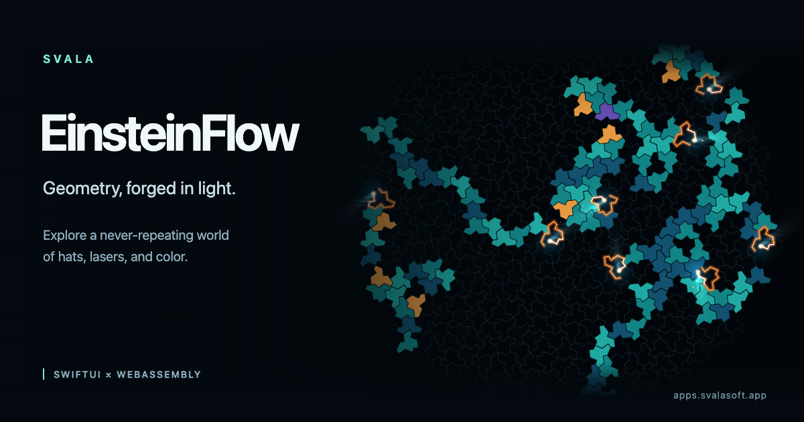

# EinsteinFlow

> SvalaSoft
>
> **[EinsteinFlow][live-demo]**
>
> Lasers trace never-repeating hat patterns in a live SwiftUI shader animation. Built with Svala for the web.
>
> [][live-demo]

[live-demo]: https://apps.svalasoft.app/us/app/einsteinflow/id8816557782/web

A shared SwiftUI shader example for **Apple iOS 17+, Mac Catalyst, and Svala**. Lasers trace the thirteen sides of genuine hat tiles, completed tiles fill with color, and the camera pulls back and rotates to reveal the growing aperiodic cluster. Choose a field of up to 2,048 hats; completed fields fade into another construction pass. Apple compiles a standard SwiftUI Metal layer effect, while Svala loads its matching SkSL torch. The application view and runtime vector geometry are shared.

You can also install the web version using your browser’s **Install app**, **Add to Dock**, or **Add to Home Screen** command. It opens at `/web` with its own EinsteinFlow icon.

The “hat” is the aperiodic monotile discovered by David Smith and developed with Joseph Samuel Myers, Craig S. Kaplan and Chaim Goodman-Strauss. Its tilings include reflected hats. See the [authors’ project and paper](https://cs.uwaterloo.ca/~csk/hat/) and the [Scientific American article](https://www.scientificamerican.com/article/newfound-mathematical-einstein-shape-creates-a-never-repeating-pattern/) that inspired this example.

The geometry port follows the authors’ BSD-licensed construction. The original notice is bundled at [EinsteinFlow/ThirdParty/hatviz-LICENSE.txt](EinsteinFlow/ThirdParty/hatviz-LICENSE.txt); [Tests/Geometry.md](Tests/Geometry.md) records the source and the construction checks.

## Controls

The **Lasers** menu selects one to eight simultaneous cutters. New cutters start in separated areas of the field, then each chooses nearby unfinished hats to build its local patch. **Speed** offers 0.25×, 0.5×, 1×, 2×, 4× and 8× cutter speeds. The arrows beside Speed adjust rotation independently, from 4× counterclockwise through stopped to 4× clockwise; the default is 1× clockwise. **Field** selects 168, 512, 1,024 or 2,048 hats. The palette buttons, Pause/Play and Hide controls remain available alongside these settings.

The **EINSTEIN FLOW** title opens the Scientific American article. The lower-right source link opens [github.com/svalasoft/EinsteinFlow](https://github.com/svalasoft/EinsteinFlow). Both use standard SwiftUI `Link` controls on Apple and Svala.

Drag the field to pan, pinch to zoom, or use the mouse wheel to zoom in and out. Once adjusted, the camera holds its manual center and scale through construction and subsequent passes. Rotation continues independently. The scope button beside **Hide controls** resets pan and zoom and restores automatic framing.

## Apple build

Open `EinsteinFlow.xcodeproj`, select **EinsteinFlow**, and choose an iPhone, iPad, simulator or **My Mac (Mac Catalyst)**. Device builds use the same automatic-signing team as the other examples; select your own team if needed.

For a local unsigned Mac Catalyst build:

```sh
./Scripts/build-xcode.sh CODE_SIGNING_ALLOWED=NO CODE_SIGNING_REQUIRED=NO
codesign --force --deep --sign - .build/xcode/Build/Products/Debug-maccatalyst/EinsteinFlow.app
open .build/xcode/Build/Products/Debug-maccatalyst/EinsteinFlow.app
```

For an iOS simulator, pass its destination explicitly:

```sh
./Scripts/build-xcode.sh \
  -destination 'platform=iOS Simulator,name=iPad Pro 13-inch (M5)' \
  CODE_SIGNING_ALLOWED=NO CODE_SIGNING_REQUIRED=NO
```

Xcode’s Metal Toolchain component is required. `Einstein.metal` is a Compile Sources input; Xcode produces `default.metallib`. The `.sksl` companion is a separate resource and is not compiled by Apple’s Metal compiler.

`project.yml` is the project source. After adding files, run:

```sh
./Scripts/generate-project.sh
```

This requires XcodeGen. Build scripts only build; they do not install on a device or change its settings.

## Svala build

The default script uses the rebuilt local SDK at `~/BriskUX/.build/nativeHost/release/Developer`, Swift 6.2.3 and the host’s native macOS architecture:

```sh
./Scripts/build-svala.sh
```

For a local Apple Silicon launch:

```sh
codesign --force --deep --sign - .build/arm64/Release/EinsteinFlow.app
open -n .build/arm64/Release/EinsteinFlow.app
```

Set `SVALA_SDK_PATH` to another SDK root or `Developer` directory, and optionally `SVALA_SWIFT_VERSION` to that SDK’s Swift version. Svala excludes only the Metal source for its invocation and copies `einsteinFlow.sksl` to the bundle root, where `ShaderLibrary.default.einsteinFlow` can resolve it. macOS builds use the SDK’s generic app icon and disable its unused Chromium runtime.

## Wasm

Select an installed SDK that contains a `wasm-6.2.3.platform` and the SwiftUI shader APIs. The current local BriskUX SDK may contain only the native and Android platforms.

```sh
SVALA_SDK_PATH=/path/to/sdk/Developer \
  ./Scripts/build-svala.sh -sdk wasm
/path/to/sdk/Developer/usr/bin/runapp .build/web
```

The same SwiftUI view, vector paths and SkSL shader are used for WebAssembly. Completed faces are accumulated in five sealed color paths and five current-batch paths, sealing each batch of 64 hats. Each frame draws these cached groups and up to eight live partial outlines. The shader adds a white-hot tip, a colored plume and moving sparks around each cutting head while preserving completed content elsewhere.

At high zoom, cached paths include only hats intersecting a padded viewport. Offscreen cutting outlines and shader heads are also excluded, while every completed hat remains in the construction model. The viewport is clipped before the layer effect, and the shader pass is skipped when no head can contribute.

Fields contain 168, 512, 1,024 or 2,048 hats from a genuine hierarchical hat tiling. Every completed face remains visible through the construction pass. After the final hat fills, the field fades and the next pass begins while rotation continues. [Tests/Construction.md](Tests/Construction.md) describes the cutter scheduling and completion checks.

Pause freezes construction and camera time. Cutter-speed and rotation changes preserve their current positions, and Reduce Motion shows a still composition without an active torch.

## Source layout

- `EinsteinFlowApp.swift` and the main view contain the shared SwiftUI app and animation controls.
- `FlowClock.swift` keeps Pause/Play and independent cutter/rotation clocks together, including view lifetime and Reduce Motion handling.
- `HatTiling.swift` contains the deterministic hierarchical hat construction.
- `TraceScene.swift` selects the connected cluster, construction route and constant-speed outline traversal.
- `LaserConstruction.swift` schedules the cutters, retains completed hats and restarts each field after its fade.
- `LaserFieldView.swift` draws the live vector paths, fill completion and camera motion.
- `CameraNavigation.swift` keeps manual camera offsets and zoom relative to automatic framing.
- `WheelZoomInput.swift` connects native mouse-wheel events to the same camera navigation model.
- `Einstein.metal` and `einsteinFlow.sksl` implement corresponding torch effects.
- `Assets.xcassets/HatField.imageset` is an optional geometry/shader reference fixture. The live scene does not display the bitmap.


## Regenerate and check the field

```sh
./Scripts/generate-hat-field.sh
DEVELOPER_DIR=/Applications/Xcode.app/Contents/Developer \
  python3 Tests/run-geometry-checks.py
```

Generation uses the checked-in Swift construction and Core Graphics on the build Mac. The resulting opaque 3072 × 3072 field is a reference asset, not the live animation. The runtime scene uses the same actual polygon geometry and requires no network access. Run `python3 Tests/run-trace-checks.py` for route, perimeter and partial-outline checks; [Tests/TraceScene.md](Tests/TraceScene.md) describes them.

## Browser regression check

`Tests/check-wasm-browser.mjs` drives the production web canvas through Chrome’s debugging protocol. It requires Node with global WebSocket support and ImageMagick’s `magick` command. Use a separate temporary Chrome profile, not your regular browser profile:

```sh
# Terminal 1: serve the already-built .build/web directory.
/path/to/sdk/Developer/usr/bin/runapp .build/web --port 8010 --no-open

# Terminal 2: isolated browser for this check.
'/Applications/Google Chrome.app/Contents/MacOS/Google Chrome' \
  --headless=new --remote-debugging-address=127.0.0.1 \
  --remote-debugging-port=9237 --user-data-dir=/tmp/einstein-flow-browser-profile \
  --no-first-run --no-default-browser-check about:blank

# Terminal 3: capture frames and write the report.
node Tests/check-wasm-browser.mjs \
  http://127.0.0.1:8010/ http://127.0.0.1:9237 \
  .build/validation/wasm-browser

# Targeted camera gestures and the 1,024-hat preset.
node Tests/check-wasm-browser.mjs \
  http://127.0.0.1:8010/ http://127.0.0.1:9237 \
  .build/validation/wasm-navigation navigation
```

The check compares field pixels outside the controls: playing must change them, Pause must freeze them, and Play must resume changes. It also exercises all three palettes, the Lasers/Speed/Field menus, clockwise/stopped/counterclockwise rotation controls, continued construction on the 2,048-hat field, control visibility, portrait and wide resizing, and browser runtime errors. Both external links are activated through the real SwiftUI controls; a browser-only recorder verifies their requested destinations without depending on remote page availability. Screenshots and `report.json` are saved in the requested output directory.

The navigation mode uses real pointer drags, a two-touch pinch and both mouse-wheel directions while playback is paused. It verifies the field moves or scales, browser zoom stays unchanged, and Center restores the original field pixels exactly after every gesture. Selecting the 1,024-hat field and Pause also checks that the wheel-input view permits the SwiftUI controls to receive input.

## Validation

The runtime tracer builds for the iOS simulator, Mac Catalyst, Svala macOS and Svala Wasm. iOS playback was inspected and native Svala launched normally. Wasm validation includes an eighteen-check controls run and an eleven-check navigation run covering actual two-touch input, both wheel directions and exact Center restoration. No browser runtime exceptions were observed. Safari playback was confirmed smooth by the user after refreshing the updated build. Chrome profiling did not establish a frame-rate increase, so this is a manual Safari confirmation rather than a measured Safari benchmark. Browser validation used the installed `19c827f301-org` Wasm SDK; set `SVALA_SDK_PATH` explicitly when the local BriskUX SDK lacks its Wasm platform.

The focused checks pass: 39 hat-geometry checks, 43 construction-route checks, 37 expandable-field checks, 60 cutter-scheduling checks, 37 clock-state checks, 37 camera-navigation checks and 214 native SkSL GPU/argument checks. [Tests/Geometry.md](Tests/Geometry.md), [Tests/TraceScene.md](Tests/TraceScene.md), [Tests/HatField.md](Tests/HatField.md), [Tests/Construction.md](Tests/Construction.md) and [Tests/Shaders.md](Tests/Shaders.md) explain their scope. Shader parity is checked separately; these tests do not claim identical color management or performance across every GPU. Android, Windows and Linux have not been run for this example.
